# Reflex

**Let an AI learn to control a real machine, on the machine, without ever being allowed to break it. A hard-real-time safety reflex for physical AI, built on QNX 8.0.**

A neural network starts with random weights and full authority over an unstable plant. It explores, makes dangerous mistakes, crashes, hangs. A small guardian process checks every command one control period ahead and takes over the instant the next step would leave the set of states it can still recover from. The network learns from being overruled. In the simulator test in this repository it goes from untrained to tracking in a few minutes, with over a hundred guardian interventions and zero failures of the plant.

```
            proposal (MsgSend)                 command
 +-------------------+        +------------------------+        +---------------+
 |  reflex-pilot     | -----> |  reflex-guardian       | -----> |  I/O node     | --> servo
 |  neural network   | <----- |  safety kernel, 1 kHz  | <----- |  (MCU) + its  | <-- sensor
 |  learns online    |  state |  TRUSTED               | sensor |  own watchdog |
 |  UNTRUSTED        | +"I had|                        |        |               |
 +-------------------+ to step+------------------------+        +---------------+
        ring 1: can fail  in"     ring 2: QNX hard real time       ring 3: hardware
                                           |
                       shared-memory telemetry + event log (wait-free)
            +-------------+-----------+-------------+-------------+-----------+
            | /dev/reflex |  rxdash   |   rxctl     |  flight     |  HAM      |
            | resmgr      |  web UI   |   campaign  |  recorder   |  restarts |
            +-------------+-----------+-------------+-------------+  guardian +
```

The demo plant is a ball on a tilting beam: open-loop unstable, cheap to build, and a control failure is visible to anyone in half a second. The safety kernel is plant-independent; porting means replacing three functions.

## Why this matters

Learned controllers outperform hand-written ones and cannot be certified with today's methods, which is what keeps them out of aircraft, vehicles, medical devices and industrial machines. The accepted answer is *runtime assurance*: wrap the unverified controller in a small verified monitor that can switch to a safe fallback. It is the subject of an aviation standard (ASTM F3269), was demonstrated by NASA-funded work on a neural-network aircraft taxiing system, and under the name *safety filter* is an active research area in robot learning, including recent work on learning directly on real robots.

- Cofer et al., "Run-Time Assurance for Learning-Enabled Systems", NASA Formal Methods 2020 (doi:10.1007/978-3-030-55754-6_21)
- Hobbs et al., "Run Time Assurance for Safety-Critical Systems: An Introduction to Safety Filtering Approaches for Complex Control Systems"
- Hsu, Hu, Fisac, "The Safety Filter: A Unified View of Safety-Critical Control in Autonomous Systems"
- Lu et al., "Safe Learning in the Real World via Adaptive Shielding with Hamilton-Jacobi Reachability", L4DC 2025

Most of that work studies the mathematics of the filter and assumes the filter itself always runs on time. Reflex is about the other half: a safety filter is only as good as the operating system's guarantee that it cannot be delayed, starved, blocked or impersonated by the thing it filters. On QNX that guarantee comes from kernel mechanisms, listed below.

## What it does when the AI fails

`rxctl campaign` injects eight faults into a healthy system, with and without the guardian, and writes a Markdown report.

| Pilot fault | Guardian's response |
|---|---|
| Process killed | Kernel disconnect pulse, fallback controller the same tick, pilot respawned |
| Frozen (SIGSTOP) | Missed deadline, fallback within the 5 ms deadline window, pilot killed and respawned after 400 ms |
| Infinite loop | Same; under `--sporadic` its CPU budget is also capped by the scheduler |
| Answers late | Stale proposals rejected, fallback until it is on time again |
| NaN / out-of-range output | Rejected the tick it arrives |
| Stuck or sign-inverted output | Passed while harmless, cut off when one more step would leave the recoverable set |
| Repeated offences | Three strikes: restart. Three restarts: quarantine, fallback flies until an operator releases it |
| Another process sends commands | Refused by sender identity, logged as a spoofing attempt |

> **Results:** put your measured `campaign.md`, latency histograms and learning curve from the QNX target here (see `docs/GUIDE.md`, part 5). Publish only numbers measured on your own target.

## Why QNX, specifically

| Need | QNX mechanism | Where |
|---|---|---|
| Guardian must never wait for the pilot | Synchronous Send/Receive/Reply: the *pilot* blocks, the guardian only ever replies | `src/ipc/rx_ipc_qnx.c` |
| One control thread, no locks | Timer pulse and pilot message arrive on the same `MsgReceive()` | `rx_server_wait()` |
| Pilot must not drag the guardian's priority down | `_NTO_CHF_FIXED_PRIORITY` disables client-priority inheritance on the channel | `rx_server_create()` |
| Only the real pilot may command the actuator | Kernel-supplied sender identity (`_msg_info.pid`), others get `EPERM` | `rx_server_wait()` |
| Detect a crash without polling | `_NTO_CHF_DISCONNECT` pulse | `rx_server_wait()` |
| Cap a runaway pilot's CPU | `SCHED_SPORADIC` budget set by the guardian on its child (QNX 8.0 has no adaptive partitioning) | `spawn_pilot()` |
| Observability that cannot hurt the control loop | Resource manager in its own process: `cat /dev/reflex` | `src/qnx/rxfs.c` |
| Who guards the guardian? | High Availability Manager restart; state resumes from shared memory | `src/qnx/rxham.c` |
| See mode switches on the kernel timeline | `trace_logf()` user events for the System Profiler | `src/guardian/main.c` |

The same sources build on Linux with a socket/timerfd backend (`src/ipc/rx_ipc_posix.c`), so the identical experiment can be run on both systems on the same board.

## Quick start

Host: Ubuntu 24.04 LTS (x86_64) with QNX SDP 8.0.2 or newer. One-time host setup: `make setup`, then `make doctor`.

```sh
# QNX 8.0 (Raspberry Pi 4/5: ARCH=aarch64, QEMU: ARCH=x86_64)
source ~/qnx800/qnxsdp-env.sh
make QNX=1 ARCH=aarch64
scp build/qnx-aarch64/* qnxuser@<target>:reflex/

# on the target
cd ~/reflex
./reflex-guardian --fresh &        # simulated plant, 1 kHz, simulator-trained pilot
./rxdash &                         # http://<target>:8080
./rxctl inject flip                # break the AI
./rxctl campaign report.md         # full evidence run (about 3 minutes)
su root -c "./rxfs &"; cat /dev/reflex

# learning from an untrained network, live
slay reflex-guardian
./reflex-guardian --fresh --hz 250 --learn &
./rxctl period 2000                # shorter episodes, faster learning
```

No hardware is needed for any of the above: the guardian includes a ball-and-beam simulator and everything runs in QEMU. With an I/O node (`firmware/reflex_io`) the same binaries drive a real beam: calibrate once with the `./rxcal` wizard (it writes `reflex.conf`), then `./reflex-demo.sh start --learn-from-sim` starts from weights trained for the hardware configuration and adapts them to the real plant. Hardware day, step by step: `docs/HARDWARE_DAY.md`.

Working on this with Claude Code: see `CLAUDE.md` and **[docs/CLAUDE_CODE_PROMPT.md](docs/CLAUDE_CODE_PROMPT.md)**. Full instructions, from a blank machine to a submitted project: **[docs/GUIDE.md](docs/GUIDE.md)**. Building the beam: **[docs/HARDWARE.md](docs/HARDWARE.md)**. Step-by-step checklist: **[docs/ROADMAP.md](docs/ROADMAP.md)**. Design notes: **[docs/ARCHITECTURE.md](docs/ARCHITECTURE.md)**.

## Repository layout

```
src/core       safety kernel (pure C, no OS calls), neural policy, online learner, telemetry
src/ipc        pilot<->guardian link: native QNX backend and Linux reference backend
src/guardian   the real-time guardian and plant I/O (simulator, serial I/O node)
src/pilot      the untrusted neural pilot: frozen or learning, with fault hooks
src/tools      rxctl (CLI, fault injector, campaign, flight recorder), rxdash (web UI), rx_simtest
src/qnx        rxfs (resource manager), rxham (HAM registration)
firmware       I/O node sketch for STM32 Black Pill / Arduino
tools          offline policy training (numpy), dashboard embedding
scripts        Ubuntu 24.04 host setup, doctor, firmware build/flash, deploy
```

## Tests

`make test` runs, faster than real time and without any OS services:

1. every pilot fault at 1000, 250 and 50 Hz, with and without the guardian; fails if a guarded run lets the ball within 1 cm of the beam end;
2. a Monte Carlo check of the recoverable-set bound: 200,000 random states per plant variant, an adversary gets one more tick at full tilt, then only the fallback controller acts; fails on any entry into the keep-out strip (this test caught a one-sided bound in an earlier version);
3. online learning from an untrained network for 15 simulated minutes; fails if the ball is lost once or the cost does not fall.

## Limits

- The recoverable-set bound is analytic and conservative for this plant, and is checked by Monte Carlo simulation and fault injection. It is not a formal proof, and it is only as good as the plant model.
- The pilot's fault modes are test hooks compiled into the pilot. Crash and freeze are injected from outside with signals.
- The guardian trusts its sensor. Sensor faults are only handled as "no ball seen".
- The pilot is isolated by interface (it is told a channel and nothing else). A guardian running as root (under HAM) spawns it as an ordinary user, never root; started by hand it runs as the same user as the guardian. A production system would give it a dedicated user and a QNX security policy.
- The online learner is a simple evolution strategy. It is slow compared with gradient-based reinforcement learning and is there to exercise the guardian, not to advance learning algorithms.

## License

MIT

## Project status

Where the build stands, as of **20 Nov 2026**. Green is done (with evidence in `results/`), the orange
node is the step in progress, grey is still to do. Use the diagram's zoom and pan buttons on GitHub; open a
stage below for what was done and where the proof is. The full checklist is `docs/ROADMAP.md`.

```mermaid
flowchart TD
    A["A · Laptop + QNX SDP 8.0"]:::done --> B["B · QNX 8.0 on the Raspberry Pi 4"]:::done
    B --> C["C · Guardian on QNX, simulated plant<br/>campaign 8/8 · learning 10 min, 0 balls lost"]:::done
    C --> D1["D1–D4 · Serial path<br/>fake I/O node · emulator firmware on the Black Pill"]:::done
    D1 --> D5["D5–D6 · Black Pill on the Pi over USB<br/>campaign 8/8 · unplug/replug · driver at boot"]:::done
    D5 --> D7["D7–D8 · Plug-and-play software<br/>protocol v2 · reflex.conf · rxcal wizard · reflex-demo.sh"]:::done
    D7 --> D9["D9 · End to end on the board over QNX<br/>v2 firmware · rxcal recovers the board's calibration · demo + campaign 8/8"]:::done
    D9 --> E["📍 YOU ARE HERE<br/>E · Mechanical build<br/>beam, pivot, servo linkage, sensor bracket"]:::now
    E --> F["F · Electronics + real firmware<br/>wiring, meter checks, make fw"]:::todo
    F --> G["G · Calibrate + first closed loop<br/>./rxcal · fallback → AI → learning · measure the stuck-fault margin"]:::todo
    G --> H["H · Evidence<br/>campaign + latency on the real beam · Linux A/B"]:::todo
    H --> I["I · Video under 3:00<br/>rxctl script demo/video.rxs"]:::todo
    I --> J["J · Submit on Devpost<br/>target 13 Dec · deadline 16 Dec 00:30 IST"]:::todo

    classDef done fill:#1f6f3a,stroke:#3fb950,color:#ffffff
    classDef now fill:#9a5b00,stroke:#ffb000,stroke-width:4px,color:#ffffff
    classDef todo fill:#30363d,stroke:#8b949e,color:#e6edf3
```



<details>
<summary><b>A–C · Laptop, QNX on the Pi, guardian on QNX</b> (done)</summary>

- QNX build with zero warnings; all ten Phase 2 checks on the Pi 4 with the simulated plant: `results/2026-11-19-pi4-sim/`.
- Fault campaign kept the ball in 8/8 with the guardian; HAM restart; rxfs `/dev/reflex`; 10 minutes of learning from scratch with 0 balls lost.
</details>

<details>
<summary><b>D1–D4 · Serial path without the beam</b> (done)</summary>

- Strict link parser with a fuzz test; reconnecting serial backend; `tools/fake_io_node.py` and `make test-serial` (`results/2026-11-20-host-fake-io/`).
- Emulator firmware on the Black Pill, campaign over real USB from the laptop: `results/2026-11-20-host-blackpill-emulate/`.
</details>

<details>
<summary><b>D5–D6 · Black Pill on the Pi over USB</b> (done)</summary>

- QNX's USB serial driver is not on the quick-start image: copied from the SDP, now started at boot (`scripts/install-autostart.sh`).
- Stale-buffer bug found and fixed (`tcflush` on open); campaign 8/8; unplug/replug survived; hardware-trained pilot with 0 interventions in 120 s; 10 min learning over USB with 0 balls lost: `results/2026-11-20-pi4-emulated-io/`.
</details>

<details>
<summary><b>D7–D8 · Plug-and-play software</b> (done)</summary>

- Protocol v2: the board reports raw readings and takes raw pulses; calibration lives on the Pi in `reflex.conf`.
- `./rxcal` wizard; `make test-cal` recovers a fake rig's wrong-in-every-way calibration; `make test-serial` flies the campaign on it.
- `./reflex-demo.sh start|stop|status`, dashboard captions, `rxctl script demo/video.rxs`. Step-by-step for the build day: `docs/HARDWARE_DAY.md`.
</details>

<details>
<summary><b>D9 · End to end on the board over QNX</b> (done)</summary>

- v2 emulator firmware flashed over ST-LINK; on the Pi, `rxcal --auto` recovered the board's hidden calibration exactly (level 1520 µs, 2.000 µs/mrad, both signs, centre 255 mm).
- `reflex-demo.sh start` chose the serial backend by itself; campaign over USB kept the ball in 8/8 with all eight faults injected: `results/2026-11-20-pi4-emulated-io/` 13–15.
- Fixed on the way: under HAM the untrusted pilot used to run as root; a root guardian now spawns it as an ordinary user.
</details>

<details open>
<summary><b>📍 Now · E · Mechanical build</b></summary>

- Build the beam, pivot, servo linkage and sensor bracket: `docs/HARDWARE.md` Parts 1–3. Nothing on the software side is waiting.
- Then, in order: wiring (Part 4), real firmware, `./rxcal`, demo in stages: `docs/HARDWARE_DAY.md`.
- Open items: two unexplained Pi reboots on 20 Nov (power and thermal now logged by `health-log.sh`); the stuck-fault margin (10.0–14.1 mm on the fake node against a 10 mm strip) must be measured on the real beam.
</details>

<details>
<summary><b>F–J · Electronics, calibration, evidence, video, submission</b> (to do)</summary>

Wiring and real firmware (`docs/HARDWARE.md` Part 4–5), calibration and the first closed loop (`docs/HARDWARE_DAY.md`), evidence on the real beam, the video from `demo/video.rxs`, and the Devpost submission (`docs/SUBMISSION.md`).
</details>
